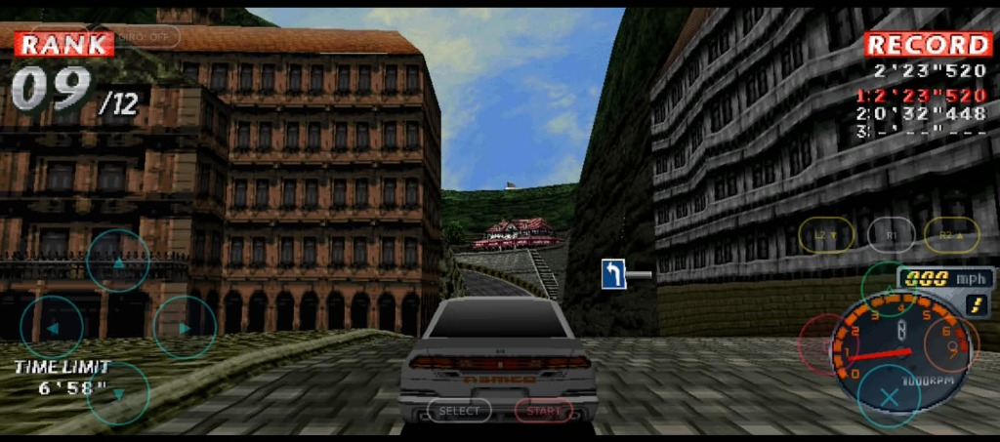
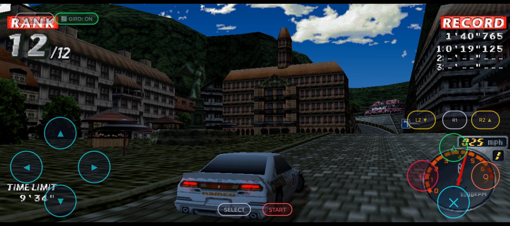
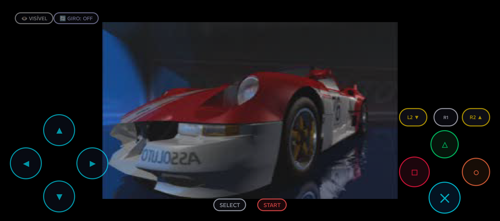
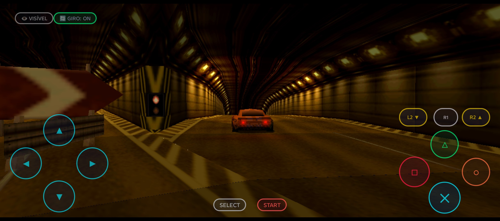
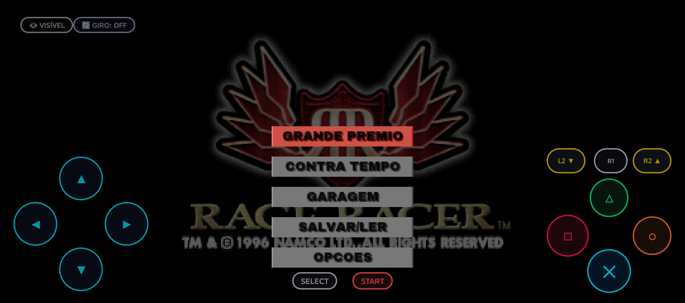
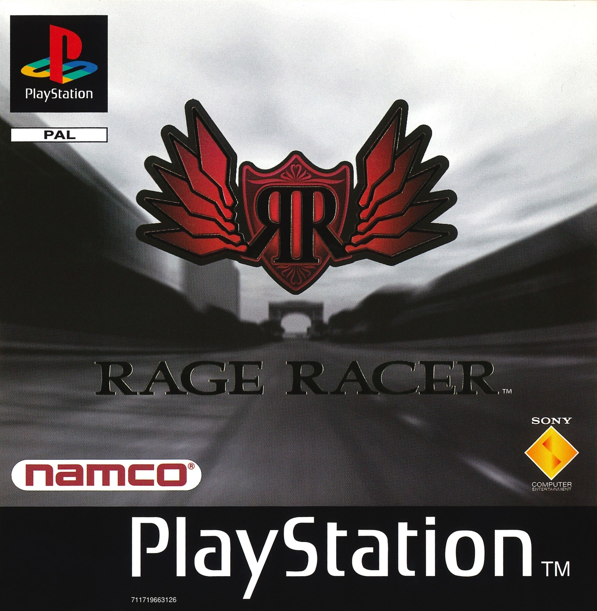

# Rage Racer — Native Android Port (C17 + Vulkan + SDL3)

[-brightgreen?logo=android)](https://www.android.com/)
[](https://developer.android.com/ndk)
[](https://www.vulkan.org/)
[](LICENSE.md)
[](README.pt-BR.md)

*Read this document in [Português do Brasil (README.pt-BR.md)](README.pt-BR.md).*

---

A 100% native **Android port** of Namco's legendary PlayStation arcade racing classic, **Rage Racer** (1996), built on top of the modern C17 decompression/reverse-engineering project with hardware-accelerated **Vulkan** graphics, **SDL3**, and a custom-crafted touchscreen & gyroscope driving system.

No emulation layers, no virtualization — compiled directly into native ARM64 machine code for butter-smooth 60/90 FPS gaming.

---

## 📸 In-Game Screenshots (Running on Android Device)

| In-Race Gameplay (Phone) | High-Speed Track Action |
| :---: | :---: |
|  |  |

| Opening Cinematic (Assoluto) | Night Tunnel (Gyro Mode Active) |
| :---: | :---: |
|  |  |

| Brazilian Portuguese UI | Original PS1 Box Cover |
| :---: | :---: |
|  |  |

---

## 🚀 Key Features

* **100% Native ARM64 Performance:** Runs directly on bare metal using Android NDK with C17. Capable of maintaining consistent 60 FPS / 90 FPS VSync with low CPU & battery utilization.
* **Modern Vulkan Renderer:**
  * Native 20:9 and 21:9 ultrawide viewport scaling (fills entire modern smartphone displays without black bars).
  * Internal 2.0x texture resolution scaling.
  * Native GPU fog and depth buffering.
* **Authentic PlayStation Touchscreen HUD:**
  * Left-hand classic cross D-pad.
  * Right-hand PlayStation geometric action cluster (✕ Accelerate, □ Brake, △ Change View, ○ Action).
  * Shifting and mirror pills (R2 Shift Up, L2 Shift Down, R1 Rearview Mirror).
  * Dedicated SELECT and START buttons.
  * Instant on-screen opacity cycle toggle (`100%` $\to$ `75%` $\to$ `50%` $\to$ `25%` $\to$ `Hidden`).
* **Zero-Latency Gravity Steering (Steering Wheel Mode):**
  * Hardware sensor fusion powered by `Sensor.TYPE_GRAVITY` at 100Hz.
  * Screen-plane vector mathematics: $\theta = \text{atan2}(g_y, g_x)$. Pitch angle cancels out completely, allowing accurate and effortless steering whether holding the phone inclined at $20^\circ$, $40^\circ$, or $75^\circ$.
  * Calibrated $4.5^\circ$ deadzone for rock-solid straight-line control and instant arcade curve turning without sluggish PWM delays.
  * Real-time toggle button (`🔄 GIRO: ON / OFF`) right at the top bar.
* **Audio & Memory Card Persistence:**
  * Full CD music and sound effect playback powered by low-latency AAudio / Oboe.
  * Complete PS1 Memory Card emulation (Slot 1 `bu00` and Slot 2 `bu10`) stored safely in Android app-private storage.
  * Integrated Brazilian Portuguese and European text localization.

---

## 🛠️ Requirements & Building from Source

### Prerequisites
1. **Android Studio** (Hedgehog / Iguana / Ladybug or newer) or Android SDK Command-line Tools.
2. **Android NDK:** Version `25.2.9519653` or `27.2.12479018`.
3. **CMake:** `3.22.1` or newer.
4. **JDK:** OpenJDK 17.

### Build Commands

```bash
# Clone the repository
git clone https://github.com/NunesFilipe/rage-racer-android.git
cd rage-racer-android

# Build the debug APK via Gradle
cd android
./gradlew assembleDebug

# Output APK location:
# android/app/build/outputs/apk/debug/app-debug.apk
```

### Install onto Connected Android Device

```bash
adb install -r android/app/build/outputs/apk/debug/app-debug.apk
adb shell am start -n org.libsdl.app/.RageRacerActivity
```

---

## 🎮 Providing Game Disc Assets

To comply with copyright laws, no copyrighted game disc images or ROM files are distributed in this repository.

To run the game:
1. Legally dump your own copy of *Rage Racer* (PAL / Europe `SCES-006.50` or NTSC-U).
2. Compress or convert the dump to CHD format named `Rage Racer.chd` (or CUE/BIN).
3. Place `Rage Racer.chd` inside `android/app/src/main/assets/` before building, or copy it directly into `/sdcard/Android/data/org.libsdl.app/files/Rage Racer.chd` via ADB:
   ```bash
   adb push "Rage Racer.chd" /sdcard/Download/
   ```
   On first launch, the app verifies and unpacks the disc assets automatically.

---

## 📜 Credits & Acknowledgments

* **Original Game:** © 1996 NAMCO LTD. (Bandai Namco Entertainment).
* **Core Reverse-Engineering & PC Port:** [khasinski/rage-racer-pc](https://github.com/khasinski/rage-racer-pc) and contributors.
* **Compatibility Layer:** [PSY-Z](https://github.com/khasinski/psyz).
* **Android Native Port, Touch Layout & Gravity Steering:** Filipe Nunes ([@NunesFilipe](https://github.com/NunesFilipe)).

---

## ⚖️ License

The port source code is licensed under the **GNU General Public License v2.0 (GPLv2)**. See [LICENSE](LICENSE) for details. All trademarks and copyrighted game assets belong to their respective owners.
