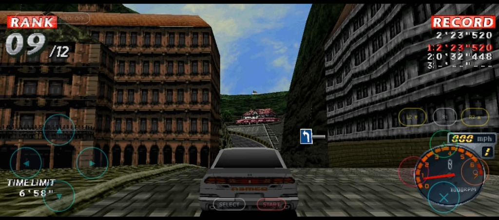
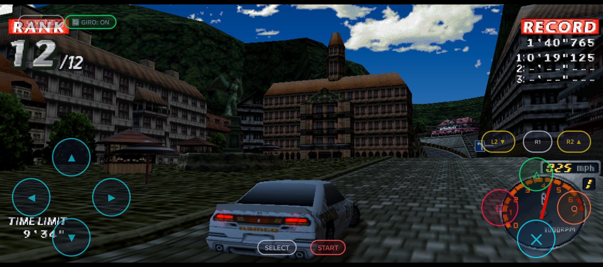
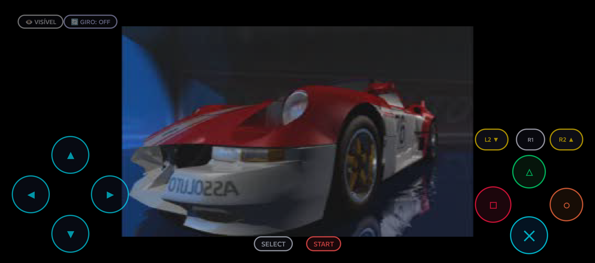
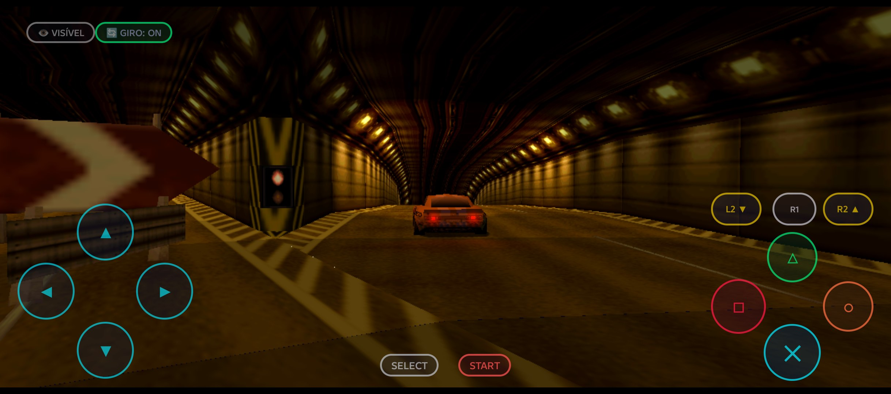
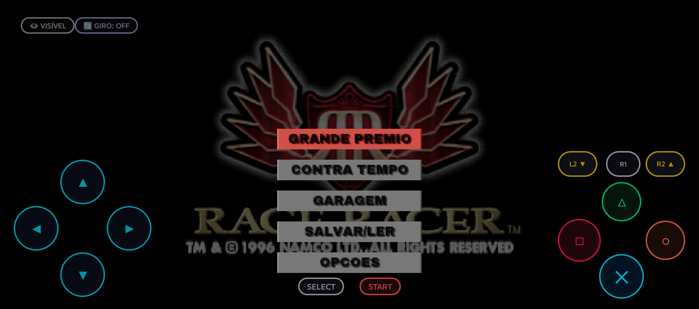
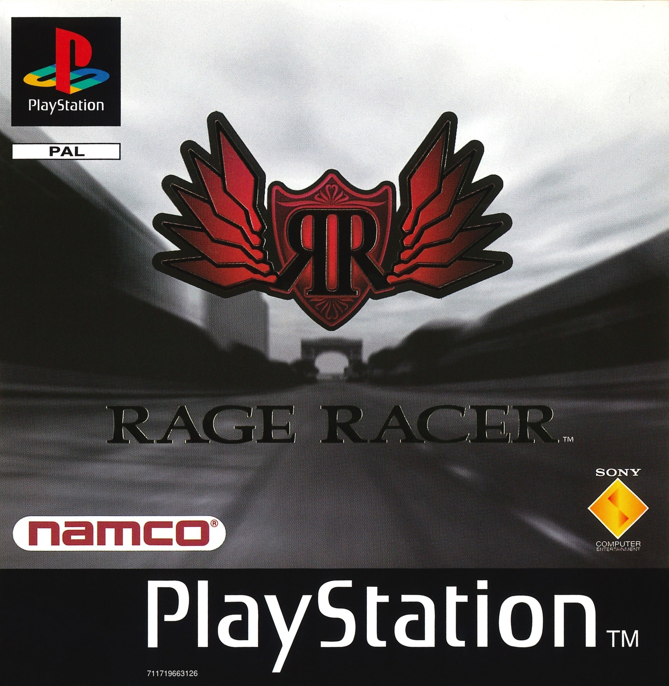

# Rage Racer — Port Nativo para Android (C17 + Vulkan + SDL3)

[-brightgreen?logo=android)](https://www.android.com/)
[](https://developer.android.com/ndk)
[](https://www.vulkan.org/)
[](LICENSE.md)
[](README.md)

*Leia este documento em [Inglês (README.md)](README.md).*

---

Port **100% nativo para Android** do clássico lendário de corrida do PlayStation 1, **Rage Racer** (Namco, 1996), reconstruído diretamente em C17 com aceleração gráfica em **Vulkan**, integração **SDL3**, e um sistema exclusivo de controles na tela estilo arcade e direção por giroscópio/gravidade sem atrasos.

Sem emuladores ou máquinas virtuais: o código roda diretamente em instruções nativas ARM64 do processador a 60/90 FPS com VSync cravado.

---

## 📸 Imagens Reais do Jogo no Celular

| Gameplay Real no Smartphone | Ação em Alta Velocidade na Pista |
| :---: | :---: |
|  |  |

| Cinemática de Abertura (Assoluto) | Modo Noturno / Giroscópio Ativo |
| :---: | :---: |
|  |  |

| Menus Traduzidos em Português | Capa Original do PlayStation |
| :---: | :---: |
|  |  |

---

## 🚀 Principais Funcionalidades do Port

* **Performance 100% Nativa ARM64:** Compilado via Android NDK sem nenhuma camada de emulação. Mantém 60 FPS ou 90 FPS constantes sem superaquecer o aparelho.
* **Renderizador Vulkan Moderno:**
  * Suporte nativo a telas ultrawide 20:9 e 21:9 (preenche toda a tela de celulares modernos sem faixas pretas).
  * Renderização interna em 2.0x com filtros de textura de alta fidelidade.
  * Nevoeiro (fog) e iluminação calculados diretamente na GPU.
* **HUD PlayStation Autêntico com Toque na Tela:**
  * D-Pad clássico em cruz à esquerda para navegação precisa.
  * Cluster geométrico do PlayStation à direita (✕ Acelerar, □ Frear / Ré, △ Trocar Câmera, ○ Ação).
  * Botões de marchas e retrovisor (R2 Subir Marcha, L2 Descer Marcha, R1 Espelho Retrovisor).
  * Botões dedicados de SELECT e START no centro inferior.
  * Botão de opacidade na tela para ajustar a transparência em tempo real (`100%` $\to$ `75%` $\to$ `50%` $\to$ `25%` $\to$ `Oculto`).
* **Direção por Gravidade (Modo Volante no Giroscópio):**
  * Fusão de sensores em hardware via `Sensor.TYPE_GRAVITY` a 100Hz (latência $< 10\text{ms}$).
  * Cálculo vetorial no plano da tela: $\theta = \text{atan2}(g_y, g_x)$. A inclinação de pegada do celular se anula matematicamente, funcionando com a mesma resposta exata segurando inclinado a $20^\circ$, $40^\circ$ ou $75^\circ$ (sem a obrigação de virar o celular em pé).
  * Zona morta calibrada em $4.5^\circ$ para estabilidade total em retas e resposta imediata nas curvas, sem atrasos de PWM.
  * Botão direto no topo da tela para ligar/desligar a qualquer momento (`🔄 GIRO: ON / OFF`).
* **Áudio e Memory Card Integrados:**
  * Reprodução completa das músicas originais em CD e efeitos sonoros via AAudio / Oboe em baixa latência.
  * Emulação autêntica de Memory Card (Slots `bu00` e `bu10`) armazenados com segurança no armazenamento interno do app.
  * Textos e menus localizados em Português do Brasil.

---

## 🛠️ Requisitos e Compilação

### Pré-requisitos
1. **Android Studio** ou Android SDK Command-line Tools.
2. **Android NDK:** Versão `25.2.9519653` ou `27.2.12479018`.
3. **CMake:** `3.22.1` ou superior.
4. **JDK:** OpenJDK 17.

### Comandos de Compilação

```bash
# Clonar o repositório
git clone https://github.com/NunesFilipe/rage-racer-android.git
cd rage-racer-android

# Compilar o APK de debug pelo Gradle
cd android
./gradlew assembleDebug

# O APK gerado ficará em:
# android/app/build/outputs/apk/debug/app-debug.apk
```

### Instalação no Celular Conectado via ADB

```bash
adb install -r android/app/build/outputs/apk/debug/app-debug.apk
adb shell am start -n org.libsdl.app/.RageRacerActivity
```

---

## 🎮 Como Inserir o Disco do Jogo

Por motivos legais de direitos autorais (DMCA), imagens de disco (ROMs) protegidas não são distribuídas no repositório.

Para rodar o jogo:
1. Obtenha o dump legal do seu próprio CD original de *Rage Racer* (versão PAL Europe `SCES-006.50` ou NTSC-U).
2. Converta para o formato CHD com o nome `Rage Racer.chd` (ou formato CUE/BIN).
3. Insira o arquivo `Rage Racer.chd` na pasta `android/app/src/main/assets/` antes de compilar, ou envie diretamente para o celular via ADB:
   ```bash
   adb push "Rage Racer.chd" /sdcard/Download/
   ```
   No primeiro início, o jogo reconhece e extrai os assets nativos automaticamente.

---

## 📜 Créditos

* **Jogo Original:** © 1996 NAMCO LTD. (Bandai Namco Entertainment).
* **Engenharia Reversa e Port de PC:** [khasinski/rage-racer-pc](https://github.com/khasinski/rage-racer-pc) e colaboradores.
* **Camada de Compatibilidade:** [PSY-Z](https://github.com/khasinski/psyz).
* **Port Nativo para Android, HUD Touch e Sistema de Giroscópio:** Filipe Nunes ([@NunesFilipe](https://github.com/NunesFilipe)).

---

## ⚖️ Licença

O código-fonte deste port está sob a licença **GNU General Public License v2.0 (GPLv2)**. Consulte o arquivo [LICENSE](LICENSE) para mais detalhes. Todas as marcas registradas pertencem aos seus respectivos proprietários.
