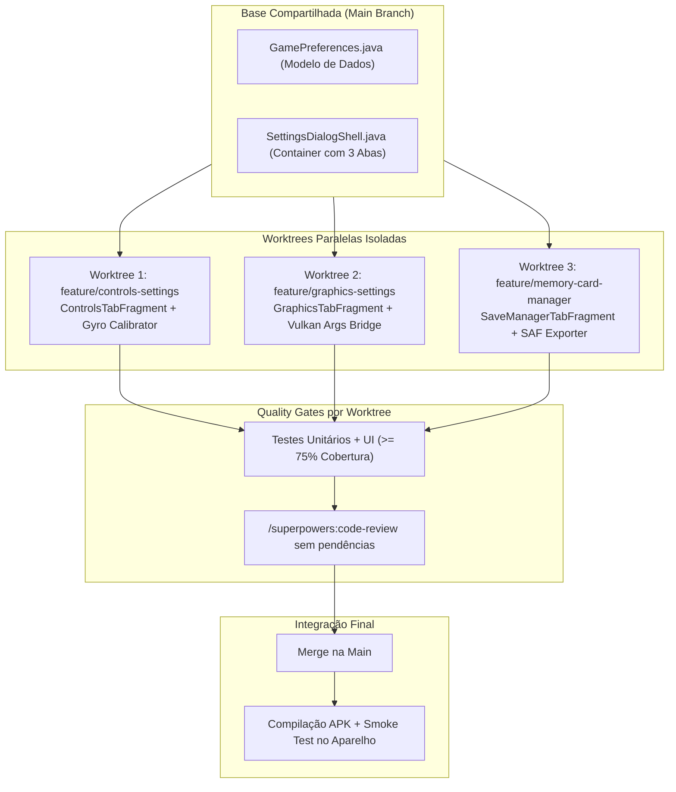

# Design Doc: Ajustes Nativos de Controles, Gráficos Vulkan e Gerenciamento de Saves

## 1. Contexto e Motivação
O port nativo do **Rage Racer (PS1)** para Android (ARM64-v8a) opera com compilação direta em C17 e renderizador Vulkan (camada PSY-Z). Para consolidar a experiência nativa sem qualquer dependência de emuladores externos, o usuário necessita de:
1. Ajuste fino de sensibilidade e zona morta do giroscópio e ergonomia dos botões de toque.
2. Controle nativo de parâmetros de renderização Vulkan (resolução interna, proporção de tela e limitação de FPS).
3. Gerenciamento e portabilidade dos saves do Memory Card (`bu00`/`bu10`) via Storage Access Framework (SAF) do Android.

---

## 2. Metas, Não-Metas e Anti-Metas

### 2.1 Metas (Goals)
* Interface in-game nativa acessível via botão `⚙️` no HUD superior, sem interromper bruscamente a sessão.
* Três abas de configuração: **Controles**, **Gráficos** e **Saves**.
* Calibração de giroscópio (deadzone configurável de $\pm 5^\circ$ a $\pm 25^\circ$, sensibilidade ajustável) e escala dos botões de toque.
* Configurações gráficas repassadas ao motor Vulkan (`renderer.scale`, `renderer.aspect`, `renderer.fps`).
* Exportação e restauração dos arquivos de save nativos do jogo para o armazenamento do usuário sem root.
* Divisão arquitetural em 3 fluxos independentes para paralelização segura em git worktrees.
* Cobertura de testes unitários mínima de 75% nos novos módulos e testes de UI.
* Code review de cada fluxo e smoke test final validado no hardware real (`Infinix X6852`).

### 2.2 Não-Metas (Non-Goals)
* Não introduzir dependências ou formatos proprietários de emuladores.
* Não modificar a lógica de física ou simulação original do jogo (`rage-sim`).
* Não reescrever texturas de 1996 nesta iteração.

### 2.3 Anti-Metas (Anti-Goals)
* Não criar telas de inicialização estilo frontend de emulador (como RetroArch) que adicionem etapas desnecessárias antes de abrir o jogo.
* Não criar acoplamento direto entre as telas filhas das abas, garantindo que as 3 frentes de trabalho possam ser executadas em paralelo sem conflitos de merge.

---

## 3. Abordagens Consideradas e Escolhas

| Dimensão | Abordagem A (Escolhida) | Abordagem B (Descartada) | Motivo da Decisão |
|---|---|---|---|
| **Acesso à UI** | Diálogo In-Game Modal (`⚙️` no HUD) | Launcher pré-jogo separado | O modal mantém a experiência direta de jogo nativo, sem etapas intermediárias. |
| **Saves** | Backup nativo estruturado dos diretórios `bu00/bu10` | Formato proprietário de emulador | O usuário exigiu explicitamente port 100% nativo sem emulação. |
| **Persistência** | `GamePreferences` centralizado (`SharedPreferences` Android) | Escrita direta de arquivos `.toml` via C | `SharedPreferences` é nativo, assíncrono, imune a corrupção de concorrência e testável via Robolectric. |

---

## 4. Arquitetura e Divisão em Worktrees

Para viabilizar a execução paralela por agentes sem conflitos de dependência, a implementação é dividida em uma base de contrato compartilhado e três fluxos desacoplados:

### 4.1 Contrato Base (Fundação Comum)
* `GamePreferences.java`: Chaves de configuração padronizadas com valores padrão saneados:
  * Controles: `gyro_enabled` (bool), `gyro_deadzone` (float), `gyro_sensitivity` (float), `button_scale` (float).
  * Gráficos: `vulkan_scale` (int 1..4), `vulkan_aspect` (int 0=4:3, 1=16:9, 2=Fill), `vulkan_fps` (int 30, 60, -1).
  * Saves: Metadados do último backup.
* `SettingsDialogShell`: DialogFragment que provê o layout de abas e delega para os 3 fragmentos independentes.

### 4.2 Stream 1: Controles & Giroscópio (`feature/controls-settings`)
* Slider de ajuste de zona morta com visualizador de inclinação em tempo real.
* Slider de escala dos botões de toque (pequeno, médio, grande).
* Integração direta com `RageRacerActivity.mFilteredTilt` e `applyTouchScale()`.
* Testes: `ControlsSettingsTest.java` (validação de ranges, clamping e persistência).

### 4.3 Stream 2: Gráficos & Vulkan (`feature/graphics-settings`)
* Seletores de Escala (1x = Nativo PS1, 2x = 720p, 3x = 1080p, 4x = 1440p/4K).
* Seletor de Aspect Ratio (4:3 Original, 16:9 Widescreen expandido).
* Mapeamento direto para argumentos nativos CLI: `--set renderer.scale=X`, `--set renderer.aspect=Y`.
* Testes: `GraphicsSettingsTest.java` (geração de argumentos e limites).

### 4.4 Stream 3: Gerenciador de Saves (`feature/memory-card-manager`)
* Detecção dos blocos de dados em `bu00/` e `bu10/`.
* Exportador via Android Storage Access Framework (`ACTION_CREATE_DOCUMENT` / `ACTION_OPEN_DOCUMENT`).
* Validação de checksum e integridade antes de substituir arquivos de save.
* Testes: `SaveManagerTest.java` (validação de leitura/escrita, streams e tratamento de falhas).

---

## 5. Plano de Testes e Validação

1. **Testes Unitários:** Cada worktree implementará seus testes unitários em `app/src/test/java/`, validando a lógica de negócio isolada com JUnit e Mockito.
2. **Cobertura de Código:** Verificação automatizada via Gradle comprovando $\ge 75\%$ de cobertura nas classes adicionadas.
3. **Auditoria de Código:** Execução de `/superpowers:code-review` em cada branch antes de aprovar o merge.
4. **Smoke Test:** Recompilação do APK, instalação via ADB no `Infinix X6852`, inicialização do jogo e teste funcional de cada uma das 3 abas.
